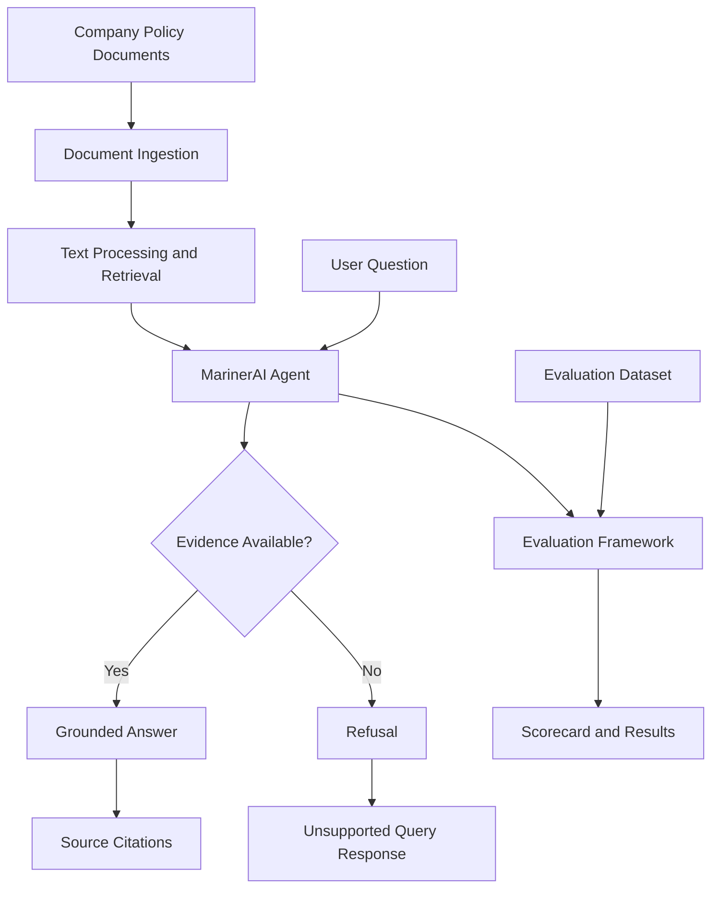

# ForgeAI - Grounded AI Agent Evaluation Framework

ForgeAI is a Python-based framework for building, testing, and evaluating AI agents that answer questions using document-based knowledge. It focuses on grounded responses, source citations, refusal of unsupported questions, and systematic evaluation.

This project includes an HR policy assistant named **MarinerAI**, developed for the fictional company Mariner Shipping Ltd.

## 1. Project Overview

MarinerAI helps users retrieve and understand information from company policy documents.

The assistant is designed to:
- Answer questions using available policy documents.
- Provide supporting source citations and quoted evidence.
- Refuse questions that are outside the available documentation.
- Avoid unsupported assumptions and fabricated policy details.
- Support evaluation of answer quality and refusal behaviour.

## 2. System Architecture



## 3. Technology Stack

- **Language:** Python
- **AI Models:** Ollama local language models
- **Agent Framework:** Custom Python implementation
- **Configuration:** YAML
- **Data Processing:** NumPy, Pandas
- **Document Processing:** PyPDF, python-docx
- **Retrieval:** BM25-based retrieval
- **Evaluation:** Custom evaluation scripts and LLM-based judging

## 4. Project Structure

```text
forgeai/
│
├── agents/
├── demos/
│   ├── hr_policy/
│   │   ├── agent/
│   │   ├── docs/
│   │   ├── evals/
│   │   └── requirements/
│   │
│   └── ship_spares/
│
├── forgeai/
│   ├── agent.py
│   ├── evalgen.py
│   ├── generator.py
│   ├── groundability.py
│   ├── ingest.py
│   ├── intake.py
│   ├── judge.py
│   ├── llm.py
│   ├── optimizer.py
│   ├── pipeline.py
│   ├── retrieval.py
│   └── schemas.py
│
├── prompts/
├── runner/
│   └── chat.py
│
├── scripts/
│   ├── eval_only.py
│   └── make_pdfs.py
│
├── tests/
│
├── workspaces/
│   └── hr_frontend_test/
│       ├── agent/
│       ├── docs/
│       ├── evals/
│       ├── iterations/
│       ├── requirements/
│       ├── scorecard/
│       └── report.md
│
└── README.md
```

## 5. Running the HR Policy Assistant

Activate the project's virtual environment, then run:

```powershell
python -m runner.chat workspaces/hr_frontend_test/agent/agent.yaml
```

The assistant will load the configured agent and accept questions through the terminal.

Type `exit` or `quit` to stop the session.

## 6. Evaluation

The HR assistant was evaluated using a fixed dataset of 21 test cases.

### Latest evaluation results

| Metric | Result |
|---|---:|
| Overall score | 85.7% |
| Passed cases | 18/21 |
| Total test cases | 21 |
| Answerable questions | 100% |
| Out-of-scope questions | 75% |
| Edge cases | 80% |

Evaluation was performed using:

```powershell
python scripts/eval_only.py workspaces/hr_frontend_test --agent agent/agent.yaml --tag improve1
```

The evaluation-only script runs the existing test cases without regenerating the evaluation dataset or changing the agent configuration.

### Known limitations

- Some unsupported questions may be incorrectly mapped to a related policy category.
- Questions involving interpretations not explicitly stated in the documents need stricter refusal handling.
- Evaluation results are based on the current test dataset and should not be treated as proof of performance on unseen questions.
- The evaluation includes judge-based assessment, which may introduce inconsistencies.

## 7. Key Project Components

| Component | Purpose |
|---|---|
| `agent.py` | Agent execution and response generation |
| `ingest.py` | Document ingestion |
| `retrieval.py` | Document retrieval |
| `groundability.py` | Evidence and answerability checks |
| `evalgen.py` | Evaluation case generation |
| `judge.py` | Evaluation and judging |
| `optimizer.py` | Agent optimization |
| `runner/chat.py` | Interactive terminal interface |
| `scripts/eval_only.py` | Evaluation without regeneration |

## 8. Future Improvements

- Improve refusal accuracy for unsupported policy questions.
- Add more policy documents and employee categories.
- Introduce a held-out evaluation dataset.
- Improve citation verification and evidence matching.
- Develop a web-based user interface.
- Expand evaluation across additional business domains.

## 9. Project Objective

The primary objective of ForgeAI is to develop reliable, document-grounded AI agents that prioritize evidence-based responses over unsupported generation.

**Project:** ForgeAI  
**Demonstration Agent:** MarinerAI  
**Domain:** HR Policy Assistance  
**Language:** Python
